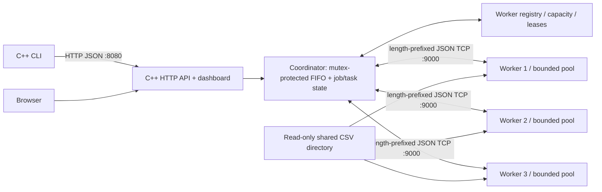

# Distributed Compute Engine · C++20

A small, working coordinator/worker engine for explaining distributed scheduling and failure recovery in interviews. All engine components, the HTTP API, CLI, computational kernels, and test harnesses are C++20. Shell scripts only build or launch the C++ programs. The dashboard is plain HTML/CSS/JavaScript.

The active implementation is C++20. The original Python implementation is preserved in Git history at `3340626`; see [migration notes](docs/migration.md). The static [project overview](https://sourya-prabaharan.github.io/dce/) describes the engine; the live dashboard runs on the coordinator at port 8080.

## Quickstart

Requirements: Linux with GCC 12+ or Clang 16+, or macOS with a C++20 compiler; CMake 3.20+, POSIX threads, `curl`, and `tar` with bzip2 support. Ubuntu/Debian: `sudo apt-get install build-essential cmake curl ca-certificates bzip2`. No Python, Node, frontend build, or separately installed Boost is required.

Run from the repository root:

```sh
sh scripts/deps.sh
cmake -S . -B build -DCMAKE_BUILD_TYPE=Release
cmake --build build -j 4
ctest --test-dir build --output-on-failure
build/dce-cli generate --output data/numbers.csv --rows 10000
sh scripts/local.sh
```

Open <http://127.0.0.1:8080>. Leave the cluster running and use another terminal:

```sh
build/dce-cli workers
build/dce-cli demo --type primes --start 0 --end 2000000 --partitions 12
build/dce-cli demo --type csv --file numbers.csv --partitions 12
build/dce-cli serial --type primes --start 0 --end 2000000
build/dce-cli serial --type csv --file numbers.csv
```

`demo` submits, waits, and prints the final job including tasks and result. `serial` runs the same computation without networking. Prime ranges are **[start, end)**. CSV statistics describe all cells together, with **population variance**. `numbers.csv` has 20,000 values, sum −10,000, mean −0.5, min −500, max 499, variance 83,333.25. The prime count below 2,000,000 is 148,933.

To exercise the documented build and end-to-end recovery from a fresh build directory:

```sh
BUILD_DIR=build-quickstart sh scripts/quickstart.sh
```

This builds all targets, runs CTest, generates data, launches three local workers on temporary test ports, submits and checks prime and CSV jobs, invokes the real CLI, verifies all three workers participated, kills an acknowledged busy worker, checks reassignment and the recovered result, and stops its child processes. Choose an unused build directory to repeat a genuinely clean build. Test output and process logs go to `run/verify-<pid>/`.

## Five-minute interview demo

1. Start `sh scripts/local.sh`; show three online workers in the dashboard.
2. Run `build/dce-cli demo --end 2000000 --partitions 12`. Show distinct worker sessions in the task list and compare with `serial`.
3. Submit `build/dce-cli submit --end 20000000 --partitions 12`; copy its `id`. While it is running, execute `kill -KILL "$(cat run/worker-1.pid)"`. Use `status --id ID`, `wait --id ID`, and `result --id ID`; show attempts increasing without a changed answer. The job is finite, so act promptly or use the automated demo below.
4. Run `build/dce-worker --id worker-1 --threads 1 --data data` in another terminal. Show a new session, explaining that this starts a new process; DCE itself never restarts a killed executable.
5. Run `sh scripts/failure-demo.sh` for repeatable, automatically timed busy-worker failures. It uses its own coordinator/ports and writes every trial to CSV, including failed targets if a trial fails.

For a configurable local cluster: `WORKERS=4 THREADS=2 sh scripts/local.sh`. Ctrl-C stops the processes launched by that script. The automated harness always uses one compute thread per worker for comparable measurements.

## Architecture



Each process has one Asio networking/event-loop thread. Workers also have a fixed computation pool. The coordinator never runs a numerical kernel. Scheduler mutations are mutex-protected for independent concurrent use and tests; socket operations run only on the owning event loop, so writes are serialized. JSON frames use `async_read`/`async_write` to handle short socket operations. The API uses Boost.Beast (part of Boost) and closes each response connection.

| File | Responsibility |
|---|---|
| `src/protocol.cpp` | Framing, complete reads, bounded ordered writes, disconnect handling |
| `src/scheduler.cpp` | Worker/session registry, attempts, FIFO dispatch, retries, aggregation |
| `src/compute.cpp` | Prime and CSV partitioning, kernels, serial execution, stable aggregation |
| `src/coordinator.cpp` | TCP registration/routing, timers, HTTP routes, dashboard |
| `src/worker.cpp` | Reconnects, heartbeats, bounded computation pool, cancellation |
| `src/http.cpp`, `src/cli.cpp` | HTTP transport and user commands |
| `tests/unit.cpp` | State-machine, numerical, concurrent queue, and socket framing tests |
| `tests/integration.cpp` | Real processes, CLI/API, batch tests, failures, benchmarks |

Boost **1.86.0** and nlohmann/json **3.11.3** are pinned, with SHA256-verified downloads in `scripts/deps.sh`. Boost.Asio/Beast are used header-only. Downloaded third-party sources retain their upstream licenses. `deps/` and build outputs are ignored; they do not need to be committed.

## Scheduling and failure behavior

- Split a job into 1–128 tasks. Put task IDs in one mutex-protected FIFO queue. Dispatch on submission, registration, completion, failure, or timer expiry; there is no periodic-only scheduling delay.
- Pick an alive worker with free slots and the smallest `outstanding / capacity` ratio. Break ties by total assignments during the session, then session ID. Every outstanding task reserves a slot until completion or loss of that session. Idle time is reported as available slot-seconds minus occupied slot-seconds.
- Heartbeats arrive every 500 ms. A 100 ms sweep expires a session after 2,000 ms without a heartbeat. Socket EOF causes immediate loss detection. An unacknowledged assignment times out after one second; an acknowledged assignment has a configurable 60-second execution lease.
- Losing a session requeues its unfinished tasks. There are at most three assignment attempts per task by default, including the first. Each assignment receives a fresh attempt ID. A matching live session, task, and attempt are required to accept a result. Duplicates and stale results have no effect on accepted results.
- Exhausting any task's attempts fails the job, skips queued siblings, and drains already-running siblings without publishing an aggregate. Deterministic malformed CSV input consequently fails after bounded retries.
- Workers reconnect with exponential backoff (100 ms to 3 s). A disconnect cancels current computations cooperatively. The worker waits for old pool work to drain before registering its next session, preserving its thread/slot bound.
- This is **at-least-once execution with idempotent result acceptance**, not exactly-once execution. A partition may execute twice after a lost connection. Workloads have no external side effects.
- SIGTERM/SIGINT close sockets and stop work; workers join their pool. A killed process requires an operator or supervisor to restart it. Coordinator state is in memory and is lost on restart; worker reconnect does not restore lost coordinator jobs.

`--timeout-ms`, `--lease-ms`, and `--attempts` configure coordinator limits. Task recovery within five seconds also requires a healthy worker slot to become available; it is a measured scenario, not an unconditional latency guarantee. FIFO can delay retries behind earlier queued work. Equal-width prime partitions have uneven computational cost, which many smaller tasks mitigate.

See [protocol and API](docs/protocol.md) for exact messages, endpoints, state transitions, and bounds, and [interview walkthrough](docs/interview.md) for tradeoffs and discussion prompts.

## Docker and separate machines

```sh
# Generate data first with the native CLI, or provide your own numeric CSV.
docker compose up --build -d
docker compose exec coordinator dce-cli workers
docker compose exec coordinator dce-cli demo --end 2000000
# View logs and stop:
docker compose logs -f
docker compose down
```

Compose starts one coordinator (also serving the API/dashboard) and three separate worker containers. `DCE_THREADS=2 docker compose up --build -d` changes slots per worker. Add/remove worker services with unique IDs to change container count. All services use the same read-only `./data:/data` bind mount. Worker services use `restart: on-failure`: **Docker** provides process restart, while **DCE** provides detection, task reassignment, and session reconnection. Deliberate `docker compose stop` does not imply automatic restart.

Three containers on one computer are three **logical worker nodes**, not three physical machines. The measured results below use local processes on one Mac, sharing its CPU, memory, disk cache, and OS scheduler. The Compose build and execution were also verified with Docker Desktop 4.57.0 / Engine 29.1.3 on Linux/arm64 (GCC 12.2); the benchmark numbers below remain the native macOS measurements.

For separate machines, build on each machine, run the coordinator with `--bind 0.0.0.0`, and run workers with `--host COORDINATOR_PRIVATE_IP --port 9000 --id UNIQUE_NAME --threads N --data /shared/data`. Point the coordinator's `--data` at the same immutable dataset via NFS or identical local copies. Keep this demo on a trusted private network: it has no authentication or TLS, and workers are trusted to report honest results. Configure the firewall for worker TCP port 9000 and API port 8080. Binding to loopback is the native default.

## Verification and measurements

Run:

```sh
ctest --test-dir build --output-on-failure
sh scripts/benchmark.sh
sh scripts/failure-demo.sh
```

The final clean quickstart passed; see [quickstart log](results/quickstart.log). Compose also passed its Linux unit tests and completed prime/CSV jobs across all three containers. Killing an acknowledged busy worker container caused one task to retry; the recovered prime count below 20 million was 1,270,607. Manually restarting that container registered a new session. See [verification details](docs/verification.md). The dashboard submission form was exercised for both workloads. An additional Apple ASan/UBSan build compiled, but its ASan runtime stalled before main(); that run is **unverified**, not a passing sanitizer check.

The tests cover fragmented/coalesced frames, malformed/oversize/truncated frames, capacity and normalized-load selection, concurrent submissions, serial numerical references and known answers, real worker failure/reassignment, coordinator-restart reconnects, heartbeat-silent reconnects, duplicate/stale results, ACK/execution leases, invalid requests, malformed result recovery, bounded retries, and a batch of 120 jobs reaching checked completed states. The test harness is C++; it uses POSIX `fork`, `execv`, signals, and monotonic clocks.

Benchmark results and hardware details are stored in `results/`. The harness checks every result against serial execution. Each of 1, 2, and 3 workers uses **one compute thread per worker** and receives one warmup plus **five measured repetitions per workload**. This is strong scaling with total compute threads increasing from 1 to 3, not a fixed-total-core or cross-machine comparison. The coordinator adds its own networking thread.

- Prime benchmark: integers [0, 8,000,000), 24 partitions, trial division with actual arithmetic.
- CSV benchmark: 500,000 rows × two numeric columns (1,000,000 values), 24 byte-range partitions; immutable shared local input with warm filesystem cache.
- Wall time includes HTTP submission, queuing, execution, aggregation, and observing the completed result with 10 ms polling. Startup, data generation, warmup, and serial verification are excluded. Throughput is one job / elapsed time or values / elapsed time.
- Slot utilization is scheduler-observed occupied slot-seconds / available slot-seconds over the measured interval. It includes network transit, not just CPU execution. It is not OS CPU utilization. There is no alternative-scheduler baseline, so this project does not claim reduced idle time.
- Failure measurements begin immediately before sending SIGKILL or SIGSTOP and end when the polling client observes a newer assignment on a different session. They include signal-delivery and observation overhead; they are conservative observed reassignment times, not exact kernel-termination timestamps. SIGSTOP leaves the connection open and independently tests heartbeat detection. Tests require the final aggregate to remain correct.

<!-- MEASURED_RESULTS -->
Measured October 5, 2026 on an **Apple M3, 8 logical CPUs, 8 GiB RAM**, macOS Darwin 25.5.0, Apple Clang 17, Release build. All workers shared this one host. Raw trials: [benchmark CSV](results/benchmark.csv), [SIGKILL CSV](results/failure-kill.csv), [heartbeat CSV](results/failure-heartbeat.csv), [hardware](results/hardware.txt), and [batch verification](results/batch.csv). Regenerate the tables with `sh scripts/summarize.sh`.

| Workload | Workers | Mean wall time (s) | Min–max (s) | Jobs/s | Speedup vs 1 worker | Slot utilization |
|---|---:|---:|---:|---:|---:|---:|
| primes | 1 | 0.7464 | 0.6890–0.8955 | 1.34 | 1.00x | 98.5% |
| primes | 2 | 0.4278 | 0.3687–0.6452 | 2.34 | 1.74x | 96.3% |
| primes | 3 | 0.2798 | 0.2602–0.3143 | 3.57 | 2.67x | 93.8% |
| csv | 1 | 0.6666 | 0.6522–0.6865 | 1.50 | 1.00x | 98.8% |
| csv | 2 | 0.5392 | 0.5113–0.5784 | 1.85 | 1.24x | 99.0% |
| csv | 3 | 0.4538 | 0.4377–0.4818 | 2.20 | 1.47x | 98.1% |

| Failure mode | Trial | Observed reassignment (ms) | Correct recovery | Within 5 s |
|---|---:|---:|---|---|
| SIGKILL | 1 | 376.865 | yes | yes |
| SIGKILL | 2 | 381.787 | yes | yes |
| SIGKILL | 3 | 402.660 | yes | yes |
| SIGKILL | 4 | 348.263 | yes | yes |
| SIGKILL | 5 | 363.007 | yes | yes |
| SIGSTOP | 1 | 1995.870 | yes | yes |
| SIGSTOP | 2 | 2005.960 | yes | yes |
| SIGSTOP | 3 | 2062.730 | yes | yes |

All 30 timed jobs matched their serial references. No failure trial missed the five-second target: **5/5 SIGKILL** recoveries, maximum **402.660 ms**, and **3/3 SIGSTOP** recoveries, maximum **2,062.730 ms**. CTest separately exercises both failure modes; these are the repeated measurement-series results, not a universal SLA. The 120-job batch completed with zero failed jobs and every prime count checked.

Five repetitions on a shared laptop are a small sample. CPU scheduling, thermal/power state, background activity, cache warmth, HTTP polling, and increasing total compute threads affect these results. Outliers were retained; configurations ran in order 1, 2, 3. No uncertainty interval or cross-machine speedup is claimed.

### Suggested resume bullets

- Built a C++20 distributed compute engine with a custom framed TCP protocol, worker registry, and parallel prime/CSV execution across three logical worker nodes.
- Implemented 500 ms heartbeats, bounded task retries, reconnecting worker sessions, and stale-result rejection; verified eight failure trials with maximum observed reassignment of 2.063 seconds and correct recovered results.
- Designed a concurrent, capacity-aware scheduler that completed 120 checked jobs; measured 2.67× prime-counting speedup with three local worker processes versus one across five trials per configuration.

<!-- END_MEASURED_RESULTS -->

## Scope and limitations

This is a focused interview/demo engine, not a production service. There is no durable job log, coordinator failover, authentication, TLS, cancellation API, tenant isolation, or sandbox for untrusted workers. Supported workloads are fixed C++ kernels; arbitrary shell commands and uploaded code are rejected. Jobs and worker sessions remain in memory up to 10,000 each; restarting clears them. Events retain the newest 10,000 records. The dashboard displays up to 100 jobs; the API has no pagination and is intended for the demonstrated workload size.

Files must remain identical and immutable across machines throughout a job; there is no content-addressed distribution or file-locking protocol. CSV has no quoted cells or header support. Parallel floating-point reduction can differ slightly from serial results, so numerical tests use a tolerance where appropriate. Prime trial division is deliberately easy to explain, rather than the fastest possible prime algorithm. Hard task leases can expire legitimate long computations: increase partition count or the lease for slower machines. No physical multi-machine, WAN, or Linux/Docker performance benchmark is claimed. Linux/arm64 container correctness and worker-kill recovery were verified.
