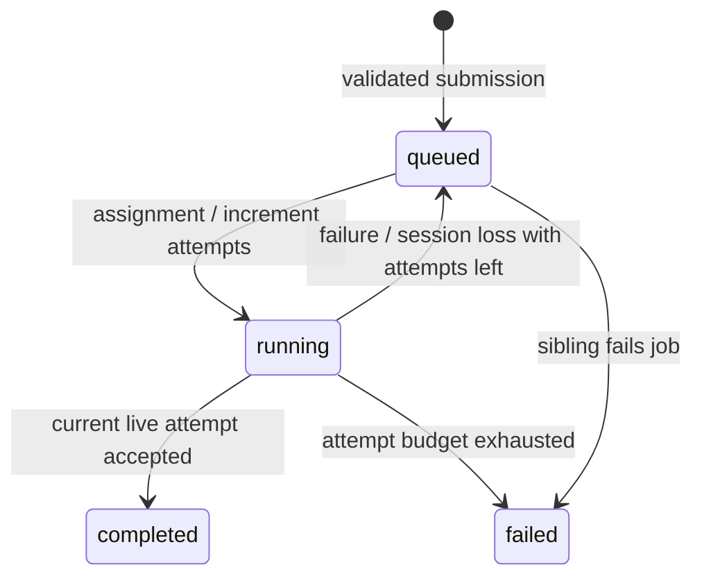

# Protocol and API

## Worker TCP protocol, version 1

Each frame is **four unsigned bytes in network byte order**, specifying UTF-8 JSON byte length, followed by exactly that many bytes. Valid lengths: 1–1,048,576. The top-level JSON must be an object. Reads tolerate partial headers, partial bodies, and multiple frames in one TCP segment. Writes are serialized and retain their buffers until completion. More than 256 queued writes closes the connection. Invalid JSON, missing required fields, unknown message types, invalid registration, oversize frames, and mid-frame EOF close the connection. An unregistered connection has three seconds to register; at most 256 worker connections are held at once. Registered connections are governed by heartbeat and assignment timeouts.

| Direction | `type` | Fields |
|---|---|---|
| Worker → coordinator | `register` | `version: 1`, `worker_id: string` (1–128 bytes), `capacity: integer` (1–64) |
| Coordinator → worker | `registered` | `session_id: string`, `heartbeat_ms: 500` |
| Worker → coordinator | `heartbeat` | No additional fields; session is bound to TCP connection |
| Coordinator → worker | `assign` | `job_id`, `task_id`, `attempt_id`, `payload` |
| Worker → coordinator | `ack` | `task_id`, `attempt_id` |
| Worker → coordinator | `complete` | `task_id`, `attempt_id`, `result` |
| Worker → coordinator | `failure` | `task_id`, `attempt_id`, `error: string` |

A new registration always gets a new session ID. Reusing a stable worker ID supersedes its old live session, requeuing old assignments. IDs use a random 128-bit process prefix and monotonic counter. No ID recycling occurs within a coordinator process. There is no persisted ID/job database. The session is implicit in the socket, so a message cannot select another worker's session by supplying a field.

Example task payloads:

```json
{"type":"primes","begin":0,"end":100000}
```

```json
{"type":"csv","file":"numbers.csv","begin":0,"end":1048576}
```

Prime task result: `{"count":9592}`. CSV task results carry `count`, `sum`, `min`, `max`, `mean`, and `m2` (sum of squared deviations). Empty tasks have count/sum/m2 zero and null min/max/mean. The coordinator merges these sufficient statistics with the parallel Welford/Chan formula:

```
delta = mean_B - mean_A
n = n_A + n_B
mean = mean_A + delta * n_B / n
M2 = M2_A + M2_B + delta² * n_A * n_B / n
population variance = M2 / n
```

The final result exposes `variance`, not internal `m2`. Means and M2 are accumulated in `long double` locally and serialized as JSON double precision. On arm64 macOS, long double may have the same precision as double; stable recurrence still avoids subtracting two large squared sums.

## States and ownership



Task ownership is `(session_id, task_id, attempt_id)`. Reassignment changes attempt ID before dispatch. Accepted completion changes state out of running; a duplicate therefore fails the same acceptance predicate. If a whole job fails, in-flight siblings drain and their answers are discarded. A job is queued before dispatch, running after dispatch, completed only when every task completes, or failed if any task exhausts attempts. A recovering job can remain running while its tasks wait for retry. No partial aggregate is returned as a completed result.

Networking and computation may disagree about whether an old attempt is still running. That is expected in at-least-once execution. The coordinator's ownership check resolves which result is authoritative. Lease expiry closes the entire worker session and requeues all its outstanding tasks; healthy siblings on that session may repeat work, favoring simple bounds over fine-grained task cancellation.

## HTTP API

HTTP/1.1 on port 8080 by default. JSON requests/responses except `GET /`. Requests have a 64 KiB body limit, 8 KiB header limit, and 5-second I/O timeout. Oversized or malformed HTTP framing closes the connection. Application validation errors return 400 JSON. Connections close after one response. No CORS grant is needed: the dashboard is same-origin.

| Method/path | Result |
|---|---|
| `GET /` | Dashboard HTML |
| `GET /health` | `{"status":"ok","protocol_version":1}`; liveness, not worker availability |
| `POST /jobs` | 201 `{"id":"..."}` |
| `GET /jobs` | Array of full job objects with task status |
| `GET /jobs/ID` | Job object or 404 |
| `GET /jobs/ID/result` | Final aggregate; 409 until completed, 404 if unknown |
| `GET /workers` | Current and historical sessions, alive flag, slots/load, heartbeat age, utilization counters |
| `GET /events` | Most recent 10,000 scheduler events, including assignment and recovery timestamps |

Submissions:

```sh
curl -sS http://127.0.0.1:8080/jobs -H 'Content-Type: application/json' \
  -d '{"type":"primes","start":0,"end":2000000,"partitions":12}'
curl -sS http://127.0.0.1:8080/jobs -H 'Content-Type: application/json' \
  -d '{"type":"csv","file":"numbers.csv","partitions":12}'
```

`partitions` defaults to 12. Accepted values: 1–128 integer. Prime bounds are nonnegative integers up to 10^10; the interval must be nonempty and at most 20 million integers. CSV files are limited to 64 MiB and must be direct children of the canonical shared directory, without path traversal or escaping symlinks. Unknown workload types and job fields are rejected. Job admission checks filenames/size, while workers validate numeric contents.

A CSV partition owns every complete line whose **starting byte offset** lies in its byte interval. Workers seek to the boundary and discard only an initial partial line, then finish each owned line even if it extends past their end offset. This avoids splitting numbers and neither omits nor double-counts boundary rows. An immutable, identical file is required on every worker.

## CLI

All options are `--name value`. HTTP host defaults to 127.0.0.1 and port to 8080; use `--host` and `--port` to change them. Worker `--port` instead refers to the TCP protocol port (9000).

- `submit --type primes --start 0 --end 1000000 --partitions 12`
- `submit --type csv --file numbers.csv --partitions 12`
- `submit --json '{"type":"primes","start":0,"end":10000}'`
- `status --id ID`, `wait --id ID --timeout 120`, `result --id ID`
- `jobs`, `workers`, `health`, `events`
- `demo` with the same workload options: submit and wait
- `serial` with workload options and `--data data`: local reference execution
- `generate --output data/numbers.csv --rows 10000`: deterministic two-column input

Failure to connect, invalid input, HTTP errors, failed jobs, and wait timeout produce stderr and nonzero exit status. Successful commands output JSON.
